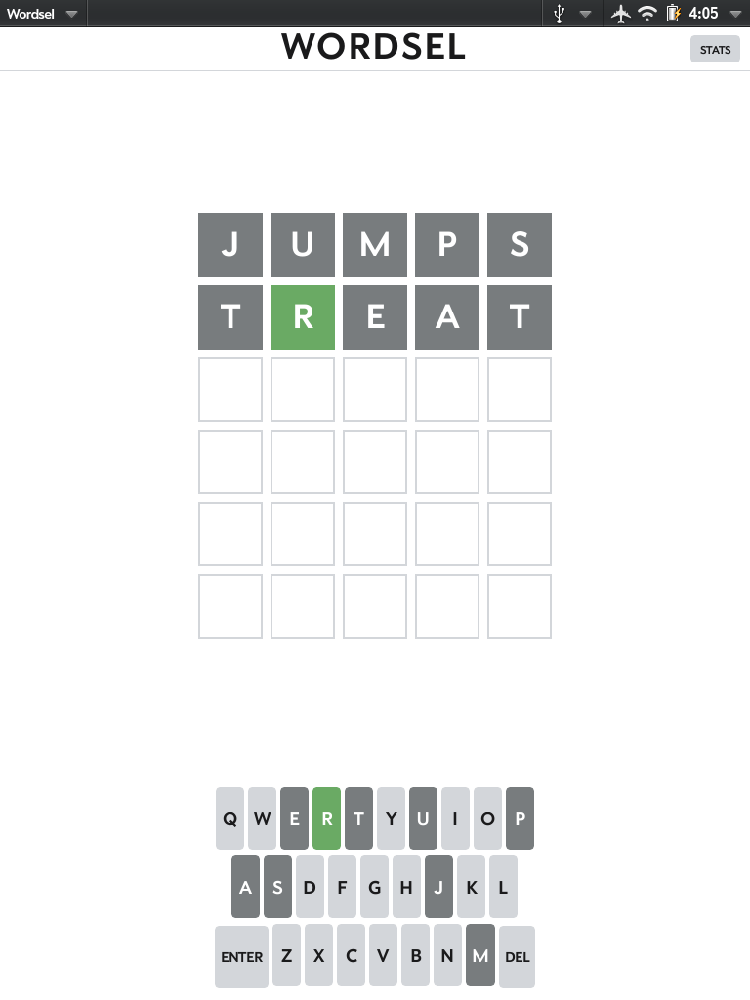
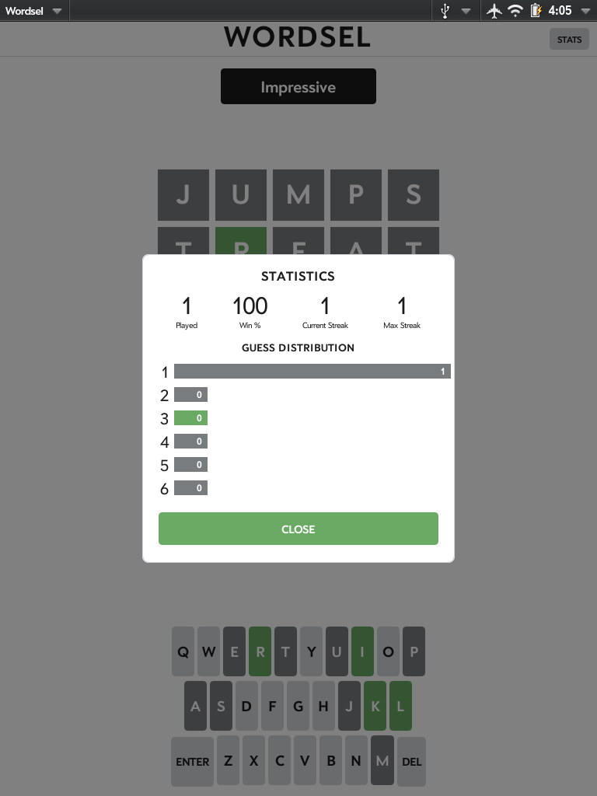

# Wordsel


A Wordle clone for **legacy HP/Palm webOS** (the Pre phones and the TouchPad).

The original Wordle is built with Web Components, ES6+, and CSS custom
properties — none of which the aging webOS browser can run. Wordsel keeps the
original's *word data and game logic* but rebuilds the entire UI in plain,
old-WebKit-friendly JavaScript and CSS, wrapped in a thin Enyo 1.0 shell so it
installs and runs as a native webOS app.

<p>
  
  
</p>

## Features

- The full daily-puzzle experience: 6 guesses, 5-letter words, color feedback.
- **Faithful to classic Wordle** — same word list and the same daily schedule
  (epoch of June 19 2021), so each calendar day's answer matches the original
  Wordle number.
- On-screen keyboard **and** hardware-keyboard input (for keyboard-equipped
  devices like the Pre, and for desktop testing).
- Tile **animations**: flip-reveal on submit, letter-entry pop, invalid-guess
  shake, and a win bounce — all degrade gracefully to instant color changes
  where the browser can't animate.
- **Statistics**: games played, win %, current/max streak, and a guess
  distribution chart, shown in a modal.
- **Progress is saved** per day, so closing and reopening restores your board;
  a new calendar day automatically starts a fresh puzzle.
- Responsive layout for both phone (320×480) and tablet (1024×768).

## How it works

The app is split into a framework-independent core and a thin webOS shell:

| File | Responsibility |
| --- | --- |
| `source/words.js` | The two word lists, extracted verbatim from the original Wordle: 2,315 ordered daily answers + 10,657 additional accepted guesses. |
| `source/game.js` | Pure game logic (no DOM): daily-answer selection, guess validation, and the two-pass tile scoring that handles duplicate letters correctly. |
| `source/storage.js` | Tiny JSON persistence wrapper (HTML5 `localStorage`, falling back to cookies). |
| `source/stats.js` | Win/loss statistics and streak tracking. |
| `source/ui.js` | The whole UI — board, keyboard, animations, messages, and stats modal — built with plain DOM so it runs on old WebKit. |
| `source/App.js` | The Enyo 1.0 shell. Owns the webOS window/chrome and mounts the DOM UI into its node. |
| `source/styles.css` | Hardcoded-color styling (no CSS variables) using the `-webkit-box` layout model the webOS browser supports. |

The core (`words.js`, `game.js`, `stats.js`, `storage.js`) has no framework
dependencies and is unit-testable under plain Node.

## Legacy-compatibility notes

The whole app is written in **ES5** and deliberately avoids APIs missing from
the webOS WebKit build: no arrow functions, `let`/`const`, template strings,
`classList`, `dataset`, `Array.fill`/`includes`, or `padStart`. A few
quirks worth knowing if you hack on the UI:

- `-webkit-box-flex` does **not** grow children to fill on this engine — it
  only honors their content width. Lay things out accordingly.
- A bare text node inside a `-webkit-box` is mis-aligned; center single
  characters with `text-align` + `line-height` instead.
- Stick to glyphs the device font actually has (e.g. the backspace key reads
  `DEL`, not `⌫`).

## Building & installing

This is an Enyo 1.0 web app packaged with the Palm/HP webOS SDK.

```sh
# from the project root
palm-package .
palm-install com.codepoet.wordsel_1.0.0_all.ipk
```

Then launch **Wordsel** from the device/emulator launcher. (`.ipk` packages
are git-ignored; rebuild with `palm-package`.)

## Development & testing

- **Reset today's puzzle:** double-tap the **WORDSEL** title. This wipes the
  saved game and restarts the same day's word so you can replay it. *This is a
  testing affordance* — remove it before a public release if you don't want it.
  (Statistics are intentionally left untouched by the reset.)
- The pure logic can be exercised in Node by loading the core files in a shared
  scope; `game.js`, `stats.js`, and `storage.js` export themselves under
  `module.exports` when run there.

## Credits

Word lists and the daily-answer / scoring algorithms are derived from the
original Wordle by Josh Wardle (powerlanguage). This project is a
fan-made port for preserving play on legacy webOS hardware.
